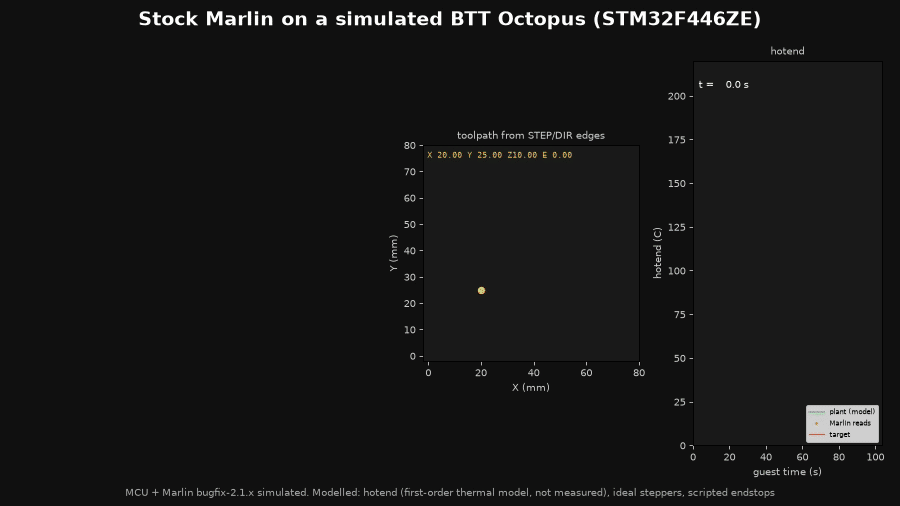
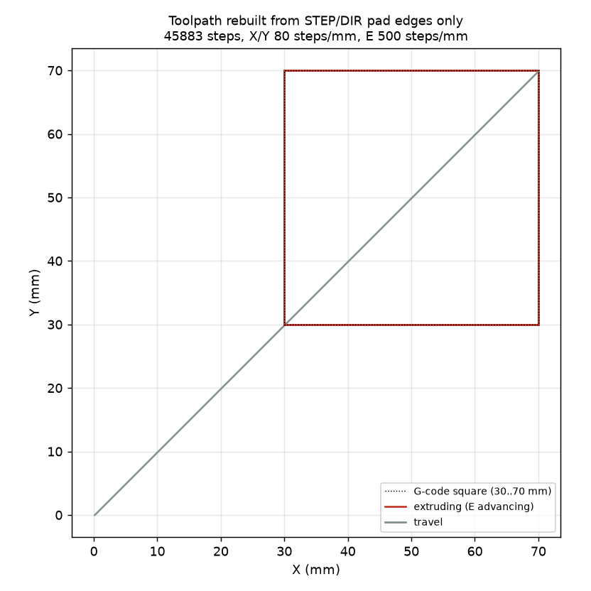
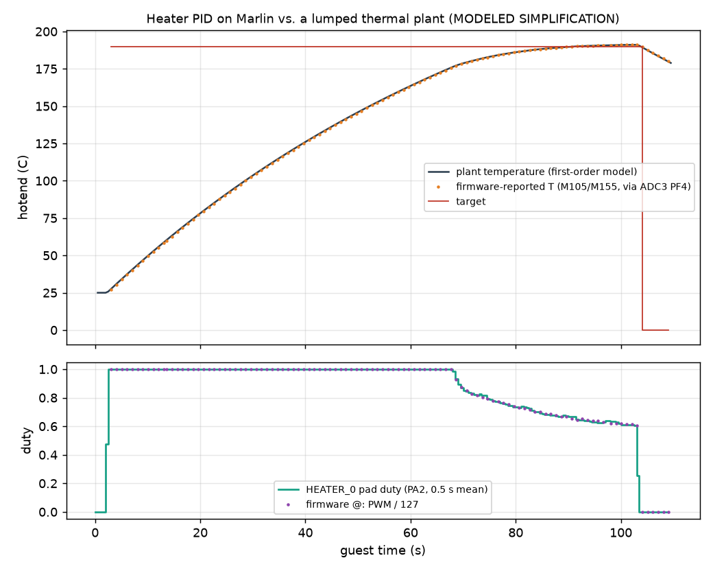
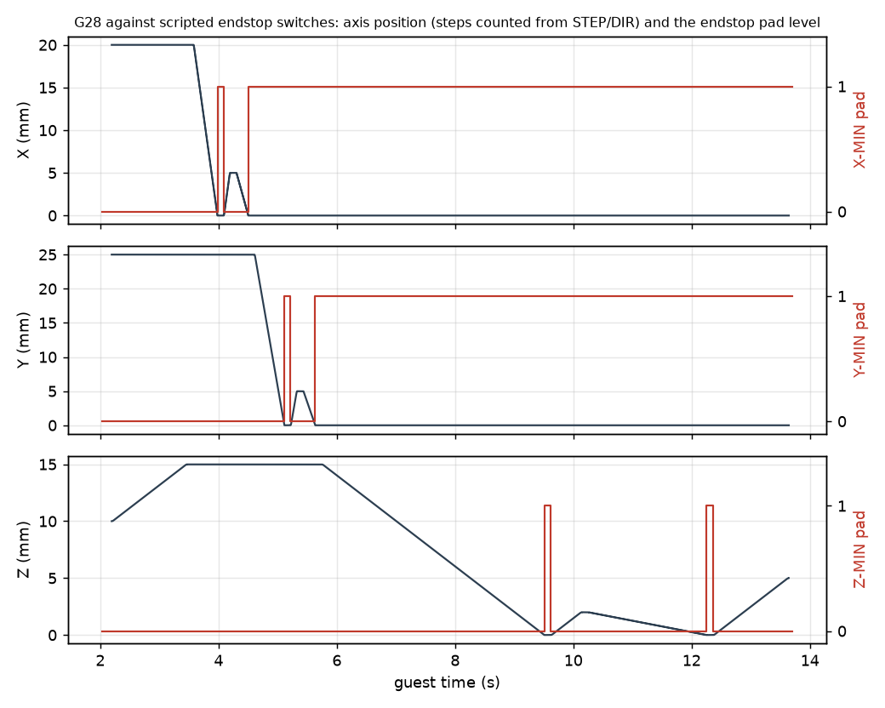
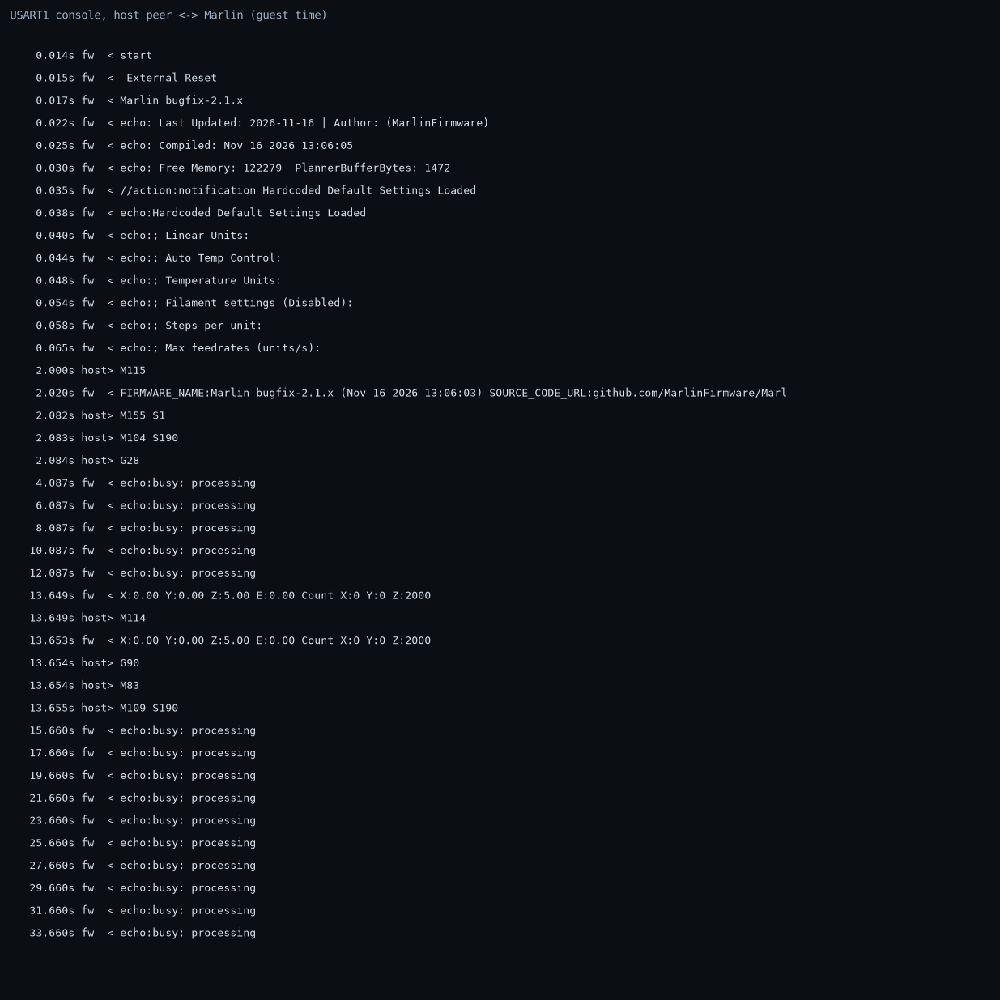
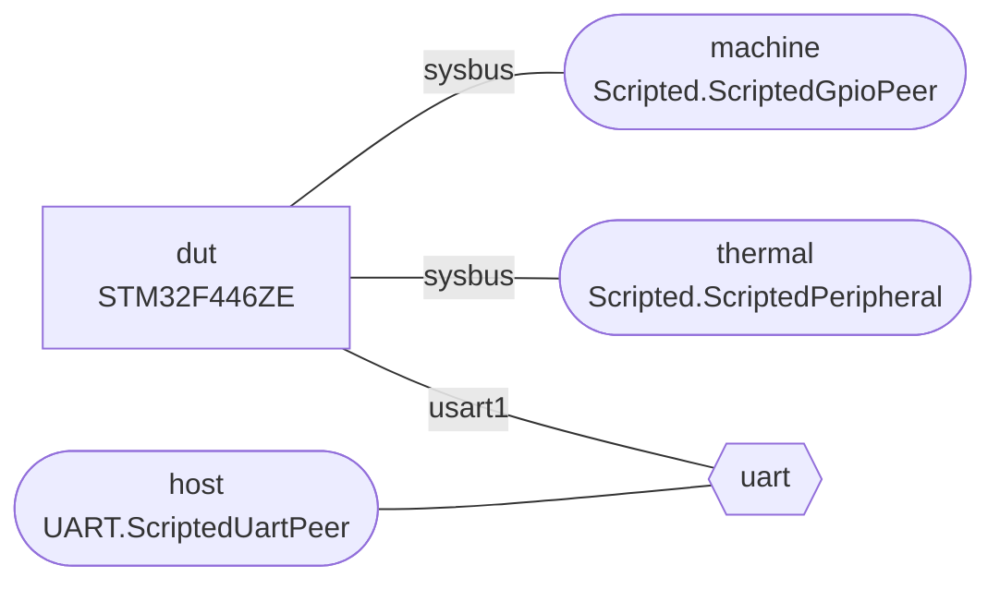
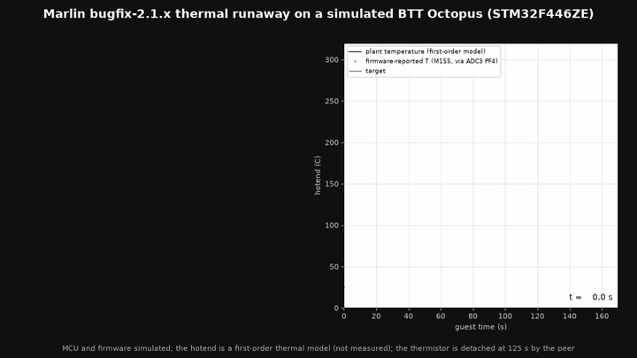
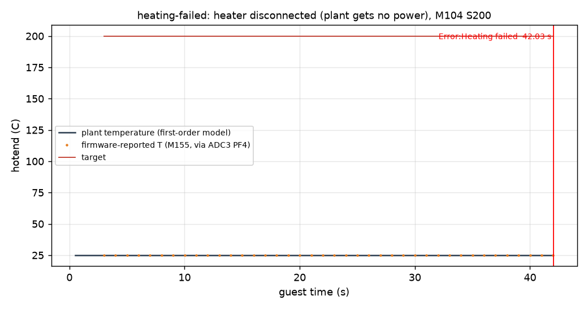
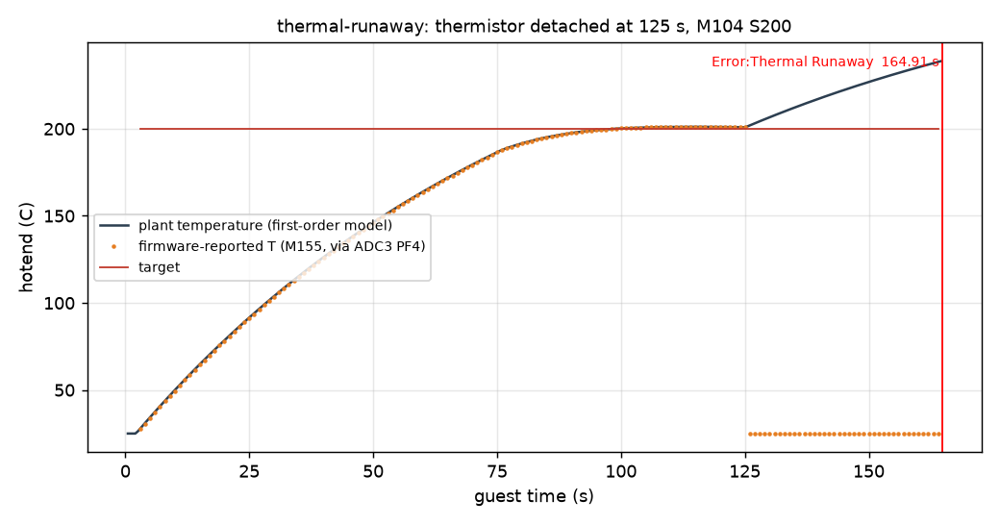
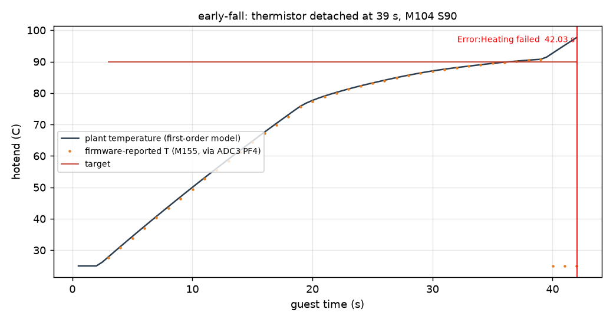

# Marlin in a simulator: a 3D printer with no printer



*One run of `sim/job.gcode` (2026-11-23, `sim` 0.10.6, committed ELF): the USART1 console in guest time, the
toolpath rebuilt live from the STEP/DIR pad edges (red extruding, grey travel), and the hotend temperature against
its target. It ends on Marlin's own `M114`: `X:70.00 Y:70.00 Z:0.30 E:6.40 Count X:5600 Y:5600 Z:120`. In this run
`M109` returned at 97.30 s. Drawn by `sim/print_video.py` ([mp4](screenshots/print.mp4)).*

Marlin (`bugfix-2.1.x`) built for the BigTreeTech Octopus V1.1 (STM32F446ZE, 12 MHz crystal) and run on a
simulated STM32F446ZE with the printer around it written as Python peers: a G-code host on the serial port, a
hotend with a heater and a thermistor, three scripted endstop switches and stepper axes that follow the STEP/DIR
pins. No board, no printer. Backend: Simantic's `sim` 0.10.1 (build ccc73c89, pyrite engine, JIT on by default).
Everything below was run on 2026-11-16.



*A 40 mm square (extruding, red) and a diagonal (travel), rebuilt only from the STEP and DIR pad edges that
`sim --trace-out` wrote. Cross-check: the peer that counted the same edges while running ends on the same
X 70.00 Y 70.00 Z 0.30 E 6.40 mm, and the firmware's own `M114` reports `Count X:5600 Y:5600 Z:120` at the end.*



*Marlin's stock PID heating the plant to 190 C (`M109 S190`), then `M104 S0`. The firmware's own `M155` readings
(orange) come back through ADC3 channel 14 and Marlin's thermistor table, and sit within 0.43 C of the plant's
true temperature over 107 reports. The lower panel is the HEATER_0 pad duty from the pad edges and the firmware's
own `@:` value divided by 127.*



*`G28`: each axis runs to its scripted endstop, backs off, and approaches again slowly (Z first hops up 5 mm, the
stock `Z_HOMING_HEIGHT`). The pad levels are the peer's switches; positions are counted from STEP/DIR.*



*The boot banner and the first G-code lines on USART1, with guest timestamps.*

## What runs

| Part | Model | Where |
| --- | --- | --- |
| Firmware | Marlin `bugfix-2.1.x`, `STM32F446ZE_btt` env, four lines of `Configuration.h` changed (below) | STM32F446ZE, `BOARD_BTT_OCTOPUS_V1_1` |
| G-code host | `host_peer.py`: sends one line, waits for `ok` | USART1 (PA9/PA10), 115200 8N1 |
| Steppers | `machine_peer.py`: ideal axes, STEP rising edge moves one step in the DIR direction, hard stop at 0 mm. A4988 standalone mode (no TMC UART/SPI) | X PF13/PF12, Y PG0/PG1, Z PF11/PG3, E0 PF9/PF10 |
| Endstops | the same peer: pad driven low until the axis reaches 0 mm, then released so the firmware's pull-up reads it high (`*_MIN_ENDSTOP_HIT_STATE HIGH`) | X PG6, Y PG9, Z PG10 |
| Hotend | `thermal_peer.py` + `printer.py`: first-order heater plant, thermistor divider written to the ADC every 10 ms | HEATER_0 PA2 in, TH0 PF4 (ADC3 IN14) out |

The scenario, as `sim graph --scenario sim/scenario.yaml` prints it:



## Configurations tried

One run of `sim/run.sh`, `sim` 0.10.1, pyrite, 2026-11-16, `--timeout 110`.

| Configuration | Virtual s | Wall s | Result |
| --- | --- | --- | --- |
| `sim/job.gcode` as shipped (M115, M155, M104 S190, G28, M109 S190, 40 mm square, diagonal, M104 S0) | 110 | 153 | MEASURED: banner at 0.014 s; `G28` finished at 13.65 s (X triggers at 3.98 s and 4.50 s, Y 5.11 s and 5.64 s, Z 9.51 s and 12.26 s); `M109` returned at 103.1 s; 14401 X / 14801 Y / 13481 Z / 3200 E steps on the pads; final position X 70 Y 70 Z 0.30 E 6.40; temperature first at 189.0 C at 87.5 s, peak 191.1 C |

Wall time is about 1.4x the virtual time on this machine (an M-series laptop with other jobs running).
Not run: a heated bed, a TMC driver over UART or SPI, the SD card, USB, bed levelling or a probe, `M303` autotune,
MAXTEMP/MINTEMP fault injection, a second run to check repeatability, anything on real hardware.
These are `unverified`.

## Run it

Needs Python 3, Simantic's `sim` 0.10.1 on PATH, and network for the first build.

```
sim/build.sh     # private venv with PlatformIO 6.1.19 and a private PLATFORMIO_CORE_DIR in .sim-tools/
sim/run.sh 110   # runs the scenario, writes sim/out/*, redraws sim/screenshots/*.png
```

If the first scons link fails with `SCons.Tool.FortranCommon`, run `build.sh` again.
`sim --trace-out` records every GPIO edge. If the firmware halts (a MAXTEMP, for example) the LED pin toggles in a
tight loop and the file grows by gigabytes in a minute, so keep `--timeout` short while changing things.

## Changes to Marlin

`Marlin/Configuration.h`, nothing else under `Marlin/`:

| Line | Stock | Here | Why |
| --- | --- | --- | --- |
| `MOTHERBOARD` | `BOARD_RAMPS_14_EFB` | `BOARD_BTT_OCTOPUS_V1_1` | an STM32F446ZE board the sim models |
| `SERIAL_PORT` | `0` | `1` | USART1 on PA9/PA10 |
| `BAUDRATE` | `250000` | `115200` | |
| `TEMP_SENSOR_BED` | `1` | `0` | no bed in the demo: one thermistor to feed |

Everything else is the stock default: A4988 drivers, `DEFAULT_AXIS_STEPS_PER_UNIT { 80, 80, 400, 500 }`,
`INVERT_Y_DIR true` (the Y peer models that), thermistor type 1 (100 kOhm, beta 4092 K, 4.7 kOhm pull-up), the
default PID (`M301 P22.20 I1.08 D114.00`), thermal protection. `sim/octopus.board` only declares the 12 MHz
crystal (`HSE_VALUE` in `buildroot/share/PlatformIO/variants/MARLIN_BTT_OCTOPUS_V1`).

## MODELED SIMPLIFICATION: the hotend

`C dT/dt = P * duty - (T - T_amb) / R_th`: one lump, explicit Euler every 10 ms of guest time, `duty` the mean
level of the HEATER_0 pad over the tick. This is the textbook first-order model. The parameters are typical
values for an E3D-V6-class hotend, **not measured on any printer**:

| Parameter | Value | Where it comes from |
| --- | --- | --- |
| P | 40 W | the usual rating of a 24 V cartridge heater |
| C | 12 J/K | about 13 g of aluminium block at 0.9 J/(g K); nozzle and heat break ignored |
| R_th | 6.9 K/W | chosen so 100 % duty settles at 25 + 40 x 6.9 = 301 C, the usual hotend ceiling |
| T_amb | 25 C | |

R_th is a fit to that ceiling, not a measurement. Marlin's default PID is the Ultimaker-derived stock value and is
not tuned for this plant: the heater is fully on until about 68 s (177 C), then the PID tapers the duty from 0.9
to 0.6 and the temperature creeps up to the target. The thermistor voltage is the inverse of Marlin's own
`thermistor_1.h` table (10-bit scale, 3.3 V reference), so the firmware reads back the plant's temperature.

Other stand-ins: the axes have no inertia, no lost steps and no limit except 0 mm; the carriages start at
X 20, Y 25, Z 10 mm (arbitrary parking positions); the endstop switch does not bounce; the heater MOSFET and the
24 V rail are not modelled, the plant sees the pad level directly.

## More scenarios: thermal protection



*Marlin halting on a detached thermistor ([mp4](screenshots/safety.mp4)). Left: USART1 as the host peer received
it, guest time. Right: the plant temperature and what the firmware read back.*

The same closed loop as above, with one fault injected into the hotend peer (`FAULT=` in `printer.py`): the
firmware's PID still drives the HEATER_0 pad and the plant still integrates it; only the heater power or the
thermistor reading is cut. Same committed image (`sim/fw/marlin_octopus.elf`, stock thermal protection:
`WATCH_TEMP_PERIOD 40`, `WATCH_TEMP_INCREASE 2`, `THERMAL_PROTECTION_PERIOD 40`,
`THERMAL_PROTECTION_HYSTERESIS 4`). Each scene sends `M155 S1` and `M104` at 2 s.

```
sim/safety.sh                                      # three scenes into sim/out/safety/, pass = error line + halt
python sim/safety_plots.py sim/out/safety sim/screenshots --video   # plots, safety.mp4, safety.gif (needs ffmpeg)
```

One run, `sim` 0.10.6, pyrite, 2026-11-23. All three scenes passed.

| Scene | Fault | Target | Firmware error | Guest s |
| --- | --- | --- | --- | --- |
| heating-failed | `heater-open`: heater disconnected, plant gets no power | 200 C | `Heating failed` | 42.03 |
| early-fall | `detach:39`: thermistor reads ambient from 39 s | 90 C (reached at 37 s) | `Heating failed` | 42.03 |
| thermal-runaway | `detach:125`: thermistor reads ambient from 125 s | 200 C (held from about 100 s) | `Thermal Runaway` | 164.91 |

**heating-failed.** The PID asks for full power (`@:127`), the temperature never moves, and the 40 s watch armed
by `M104` expires:

```
41.002769  T:25.00 /200.00 @:127
42.002770  T:25.00 /200.00 @:127
42.029004 Error:Heating failed, system stopped! Heater_ID: E0
42.030748 echo:Heating Failed
42.033967 Error:Printer halted. kill() called!
```



**thermal-runaway.** The hotend holds 201 C; at 125 s the thermistor leaves the block. Marlin sees 25 C, drives
the heater at full power, and halts 40 s later. Meanwhile the plant, still heated, climbs to 238.8 C: on a real
printer that is the hazard this check exists for.

```
122.002683  T:201.06 /200.00 @:79
127.002773  T:25.00 /200.00 @:127
164.002771  T:25.00 /200.00 @:127
164.909093 Error:Thermal Runaway, system stopped! Heater_ID: E0
164.910924 echo:THERMAL RUNAWAY
164.914144 Error:Printer halted. kill() called!
```



### Finding: the heating watch is only checked at the end of its period

**early-fall.** The hotend reached its 90 C target at 37 s (`T:90.11 /90.00`), then the thermistor fell at 39 s.
Marlin reported **Heating failed** at 42 s, not thermal runaway:

```
37.002680  T:90.11 /90.00 @:42
42.002770  T:25.00 /90.00 @:127
42.029004 Error:Heating failed, system stopped! Heater_ID: E0
```

The watch armed by `M104` (`HeaterWatch` in `temperature.h`, checked in `Temperature::manage_hotends()`) is
looked at only when its 40 s period expires (2 s + 40 s = 42 s). Reaching the target mid-period does not cancel
it; at the check the reading (25 C) was below the watch threshold, so the heating-failed path fired first. When a
check passes but the temperature is still more than `THERMAL_PROTECTION_HYSTERESIS` below the target, the watch
re-arms for another 40 s. A first runaway attempt with the fall at 120 s hit exactly that: the 82 s check saw
193 C (below 196 C), re-armed, and the 122 s check reported `Heating failed` at 122.03 s. Moving the fall to 125 s,
after the watch had disarmed, gives the runaway path. This is Marlin's own logic, not a simulator artefact.



Modelled: the MCU and firmware run unmodified; the hotend is the first-order plant above (not measured); the
faults are idealised (an open heater delivers exactly 0 W, a detached thermistor reads exactly 25 C at once).
Not run: MAXTEMP, MINTEMP, a shorted thermistor, a heated bed, anything on real hardware.

## Gaps

- **A halted firmware spins the LED pin.** After `kill()` PA13 toggles every few hundred ns, so a `--trace-out`
  file reaches gigabytes (seen: 7.2 million edges in 6 s of guest time). That is the firmware's own halt loop; the
  trace is unbounded.
- **Slower than real time**: about 1.4 s of wall time per guest second here.
- **`ScriptedPeripheral` has no clock** (`ctx.now_us` raises `AttributeError`), so `thermal_peer.py` counts its own
  exact periodic ticks. Other peer types have `now_us`.
- **Scenario `uart-device` parts take no `config:`** (only `gpio-device` does), so `host_peer.py` reads its G-code
  file from `$JOB`.

## Licence

Marlin is free software under the **GNU General Public License v3** (`LICENSE`: "Version 3, 29 June 2007"; the
source headers say "version 3 of the License, or (at your option) any later version"). This fork keeps the licence
and the copyright notices; the files under `sim/` are offered under the same terms. Upstream is
https://github.com/MarlinFirmware/Marlin. This is an unofficial simulation showcase and has not been submitted
upstream.
