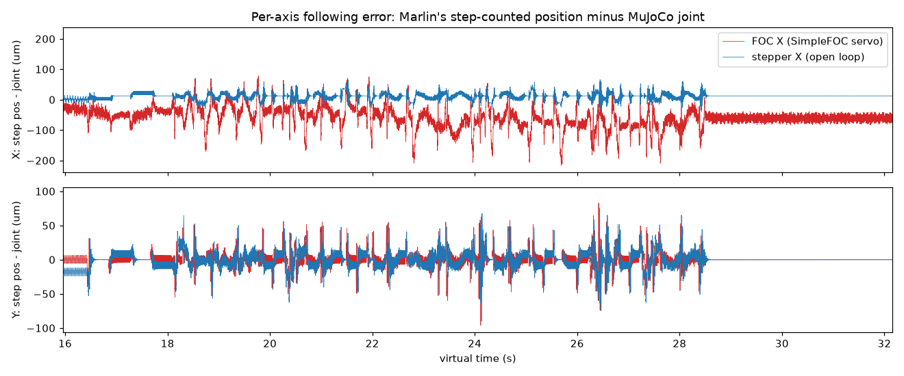

# Stock Marlin on a simulated Teensy 4.1 prints the Simantic logo on a MuJoCo printer


([MP4](media/logo-foc.mp4), 2x real time, FOC X-only run.)

Stock, unmodified Marlin `bugfix-2.1.x` (only `MOTHERBOARD BOARD_TEENSY41` set) runs on a simulated Teensy 4.1 in
Simantic's pyrite simulator and drives a MuJoCo Cartesian printer. X and Y can run on closed-loop FOC servos, an
upgrade some printers use: a second simulated Teensy 4.1 runs SimpleFOC for both axes, each with its own encoder,
bridge and motor model ([foc/](foc/)). Z and E are steppers.

| X / Y drive | RMS | p95 | max | drive loop rate per motor |
|---|---|---|---|---|
| FOC X and Y, one drive Teensy | 52 um | 94 um | 188 um | 9,180 Hz |
| FOC X only, Y stepper | 36 um | 69 um | 141 um | 18,350 Hz |
| steppers, open loop | 14 um | 25 um | 80 um | - |

*Path error: distance from each 1 kHz nozzle sample, taken while E advances, to the nearest extruding G-code segment
(387 mm printed at 40 mm/s, 80 mm wide). The FOC X-only and stepper rows are this commit's runs, with the park move.
The FOC X+Y row is from the previous commit's runs (b829f78, same G-code without the park move); the other two rows
reproduced their previous numbers exactly, since the park move is after the last extrusion.*


*The whole print, with a zoom on the worst point of the X+Y servo run.*

## More graphs


*Error peaks on corners and after travel moves, for both servo runs.*


*Distribution of path error per run.*



*Marlin's step-counted position minus the MuJoCo joint, X (top) and Y (bottom).*

## Run it

Needs a pyrite `sim` build that is not released yet (i.MX RT FlexPWM peek, USB CDC console hold), PlatformIO, and
Python with `mujoco`, `numpy`, `Pillow`, `matplotlib`.

```sh
# Marlin bugfix-2.1.x (9efefed) with MOTHERBOARD BOARD_TEENSY41: pio run -e teensy41
export MARLIN_ELF=<marlin>/.pio/build/teensy41/firmware.elf SIM=/path/to/sim MUJOCO_SITE=<venv>/lib/python3.x/site-packages
(cd sim/teensy41-mujoco/foc && pio run -e teensy41_ff_fast -e teensy41_ff_fast_xy)
cd sim/teensy41-mujoco
for p in "" a b; do uv run --with svgelements python logo_gcode.py 80 1 simantic_logo.svg $p > logo${p:+-$p}.gcode; done
for r in logo-foc-xy logo-foc logo-step; do
  python run_logo.py $r-a logo-a.gcode 30 && python run_logo.py $r-b logo-b.gcode 36
  python merge_halves.py out/$r-a out/$r-b out/$r
done
python accuracy.py logo.gcode out/logo-foc-xy "FOC X+Y, one drive Teensy" out/logo-foc "FOC X only" out/logo-step "stepper X+Y"
python video.py out/logo-foc logo.gcode media/logo-foc.mp4 2
```

## Modelled vs stand-ins

- Both MCUs run unmodified binaries; mechanics are MuJoCo (`printer.xml`), belt and stepper stiffness from datasheets
  (`peers/printer_plant.py`), a dq PMSM model and MT6835 encoder per servo axis.
- MODELED SIMPLIFICATION: belt and rail damping (zeta 0.1) is a stand-in, no datasheet value.
- MODELED SIMPLIFICATION: each run is two half prints (`logo-a`, `logo-b`) joined by `merge_halves.py`, because one
  FOC run over the whole logo takes over 5 min wall time.
- Not yet tested: whether the servo overshoot comes from the SimpleFOC gains or the plant model.
- Not modelled: step loss, heating (thermistors held at 25 C), more than one layer.
