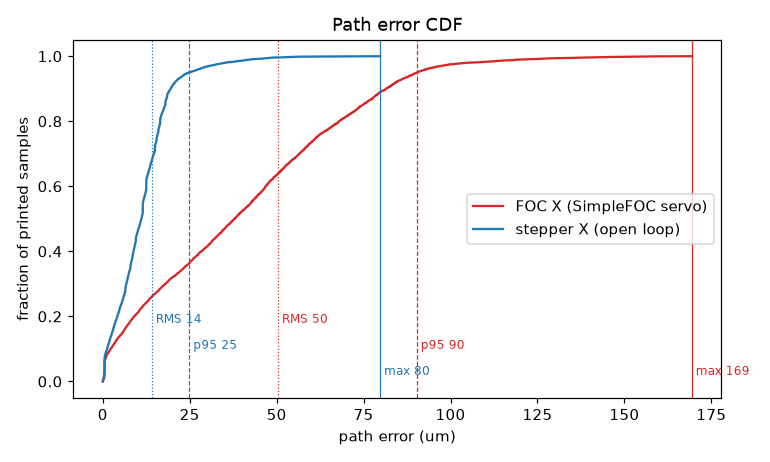

# Stock Marlin on a simulated Teensy 4.1 prints the Simantic logo on a MuJoCo printer


([MP4](media/logo-foc.mp4), 2x real time. Left: the MuJoCo printer. Right: Marlin's USB console and a top view of
the G-code (grey) against the path the nozzle actually took, coloured by path error.)

Marlin `bugfix-2.1.x` (revision 9efefed, 2026-11-20), built with `env:teensy41` and one line changed in
`Configuration.h` (`MOTHERBOARD BOARD_TEENSY41`), runs on a simulated Teensy 4.1 (i.MX RT1062) in Simantic's
pyrite simulator. G-code goes in over USB CDC. A Python peer counts the STEP/DIR pad edges, each stamped at its own
virtual time, drives the endstops and steps a MuJoCo Cartesian printer every 40 us of virtual time.

**X on a closed-loop FOC servo (an upgrade some printers use); Y/Z/E steppers.** Most printers run every axis open-loop on steppers. Here the X axis is not a stepper. Marlin's X STEP/DIR pins are wired to a **second simulated Teensy 4.1** running a
SimpleFOC 2.3.4 servo drive (voltage-mode FOC, `StepDirListener`, velocity feedforward from the step rate). The drive
reads an MT6835 encoder over LPSPI4 and drives a 3-PWM bridge on FlexPWM2. A PMSM model (Nanotec DB42S02 values)
turns the rotor, and a GT2 belt couples it to the MuJoCo carriage. Y, Z and E are steppers. The servo lags and
overshoots on corners, so the printed logo comes out slightly off. The numbers below come from the run logs.

## Accuracy

Both runs use the same firmware and G-code (`logo.gcode`: 18 perimeters, 387 mm printed at 40 mm/s, one 0.3 mm
layer, 80 mm wide). Path error is the distance from each 1 kHz MuJoCo nozzle sample, taken while E advances, to the
nearest extruding G-code segment. Following error is Marlin's step-counted position minus the MuJoCo joint.

| X drive | samples | RMS | p95 | max | X following max | Y following max |
|---|---|---|---|---|---|---|
| **FOC servo** (SimpleFOC, `teensy41_ff_fast`) | 9114 | **50 um** | **90 um** | **169 um** | 212 um | 96 um |
| stepper, open loop (datasheet belt + motor stiffness) | 9147 | 14 um | 25 um | 80 um | 66 um | 90 um |


*The whole print, with a zoom on the worst point: the FOC run overshoots the tip of the final "c" by 169 um.*

Is the FOC overshoot from the SimpleFOC controller or from the plant model? Not yet tested: a sweep of plant damping and belt stiffness with the FOC gains unchanged was started but not finished.


*The error peaks on corners and after the 100 mm/s travel moves. The FOC drive also carries a steady 40-90 um
offset along the long X runs: a velocity-tracking lag that the angle loop corrects only slowly.*




*X with FOC (red) runs 50-200 um behind and stays about 60 um off at rest after the print: the servo's steady-state
angle error and its ripple. With a stepper on X (blue), the trace sits 12.5 um (one step) off at rest. That is
one step of difference between Marlin's count and the peer's count at the end, not motion. Y is a stepper in both
runs and looks the same in both.*

Marlin's own `M114` at the end is `X:137.22 Y:95.47 Z:5.00 E:19.29 Count X:10977 Y:7638 Z:2000` in both runs. The
peer's Y count matches (95.4750 mm = 7638 steps). With the stepper, the MuJoCo X joint ends at 137.2000 mm. With
FOC it ends at 137.2716 mm, 59 um past Marlin's 137.2125 mm.

## Run it

You need a pyrite `sim` build that has the i.MX RT FlexPWM register peek: the FOC plant reads the duty cycles
through it. That change and the USB CDC console hold are not in a released `sim` yet, so this demo cannot be rerun
with a public build today. You also need PlatformIO, and Python with `mujoco`, `numpy`, `Pillow` and `matplotlib`.

```sh
# Marlin: a bugfix-2.1.x checkout (9efefed) with only MOTHERBOARD BOARD_TEENSY41 set (this branch's Configuration.h
# is set up for the Octopus demo), then: pio run -e teensy41; export MARLIN_ELF=<that checkout>/.pio/build/teensy41/firmware.elf
(cd sim/teensy41-mujoco/foc && pio run -e teensy41_ff_fast)   # the SimpleFOC drive
cd sim/teensy41-mujoco
uv run --with svgelements python logo_gcode.py 80 1 > logo.gcode     # simantic_logo.svg -> G-code
export SIM=/path/to/sim MUJOCO_SITE=/path/to/venv/lib/python3.x/site-packages
python run_logo.py logo-foc logo.gcode 45              # out/logo-foc/: sim.txt, trace.txt, frames.jsonl
python run_logo.py logo-step logo.gcode 35             # the stepper comparison
python accuracy.py logo.gcode out/logo-foc "FOC X (SimpleFOC servo)" out/logo-step "stepper X (open loop)"
python video.py out/logo-foc logo.gcode media/logo-foc.mp4 2
```

Measured on 2026-11-23 on an Apple M5. The FOC run reaches 32.2 s virtual inside a 330 s wall-clock limit, with
77 s of CPU for Marlin and 248 s for the drive Teensy. The stepper run takes 71 s wall.

## What is modelled, and what stands in

- **Firmware:** both MCUs run unmodified binaries: stock Marlin, and the SimpleFOC drive in `foc/src/main.cpp`. The
  drive gains come from the earlier v4 iterations and were not retuned for this print.
- **Mechanics:** MuJoCo (`printer.xml`). X/Y belt stiffness comes from the Gates 17611-T GT2 modulus. Stepper
  stiffness comes from the NEMA17 holding torque times 50 rotor teeth. Both derivations are in
  `peers/printer_plant.py`.
- **Motor and encoder:** a dq PMSM model with Nanotec DB42S02 datasheet R and pole count, and the MT6835 21-bit
  angle read.
- MODELED SIMPLIFICATION: belt and rail damping (zeta 0.1) has no datasheet value and is a stand-in. The bridge
  uses averaged switching with no current sensing, and the plant steps every 40 us (one 25 kHz PWM period).
- **Not modelled:** step loss, heating (thermistors are held at 25 C and `M302 P1` allows cold extrusion), and
  more than one layer.
- `simantic_logo.svg` is the official Simantic logo.
