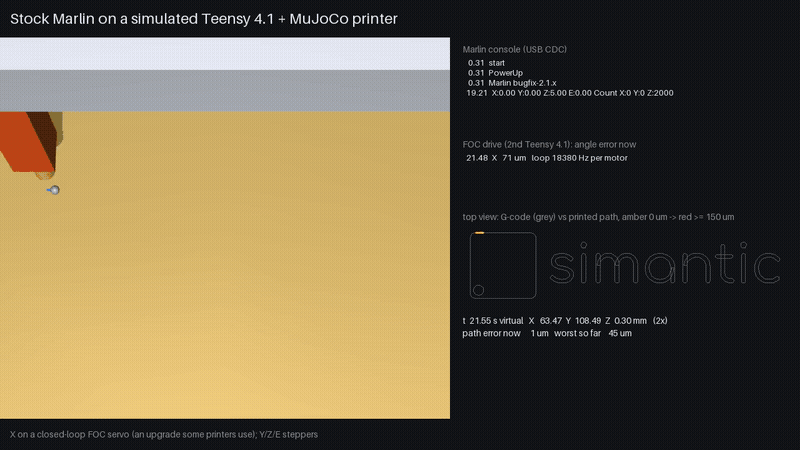
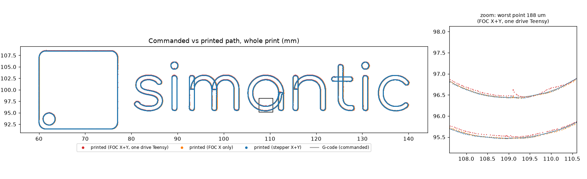
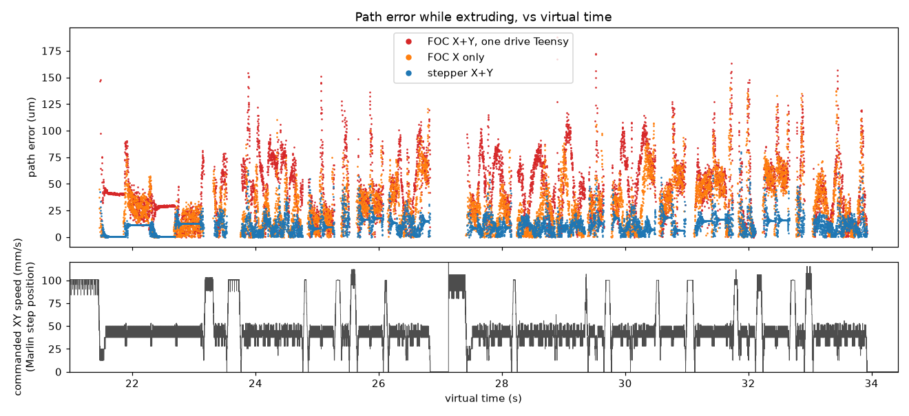

# Stock Marlin on a simulated Teensy 4.1 prints the Simantic logo on a MuJoCo printer



([MP4](media/logo-foc.mp4), 2x real time, the X+Y servo run. Left: the MuJoCo printer. Right: Marlin's USB console,
the drive's live angle error and loop rate, and a top view of the G-code (grey) against the path the nozzle actually
took, coloured by path error. The two half prints are joined at about 27 s virtual.)

Marlin `bugfix-2.1.x` (revision 9efefed, 2026-11-20), built with `env:teensy41` and one line changed in
`Configuration.h` (`MOTHERBOARD BOARD_TEENSY41`), runs on a simulated Teensy 4.1 (i.MX RT1062) in Simantic's
pyrite simulator. G-code goes in over USB CDC. A Python peer counts the STEP/DIR pad edges, each stamped at its own
virtual time, drives the endstops and steps a MuJoCo Cartesian printer every 40 us of virtual time.

**X and Y on closed-loop FOC servos (an upgrade some printers use); Z/E steppers.** Most printers run every axis
open-loop on steppers. Here X and Y are not steppers. Marlin's X and Y STEP/DIR pins are wired to **one second
simulated Teensy 4.1** running two SimpleFOC 2.3.4 servo axes (voltage-mode FOC, `StepDirListener`, velocity
feedforward from the step rate) from one `loop()`. Each axis reads its own MT6835 encoder on LPSPI4 (CS pins 10 and
9) and drives its own 3-PWM bridge (X on FlexPWM2, Y on FlexPWM4/FlexPWM1; [foc/PINS.md](foc/PINS.md)). A PMSM model
per axis (Nanotec DB42S02 values) turns each rotor, and a GT2 belt couples it to the MuJoCo carriage or gantry. Z and
E are steppers. The drive uses the same gains on both axes, tuned earlier for X alone and not retuned. The servos lag
and overshoot on corners, so the printed logo comes out slightly off. The numbers below come from the run logs.

## Accuracy

Three runs, same Marlin firmware and G-code (`logo.gcode`: 18 perimeters, 387 mm printed at 40 mm/s, one 0.3 mm
layer, 80 mm wide). Path error is the distance from each 1 kHz MuJoCo nozzle sample, taken while E advances, to the
nearest extruding G-code segment. Following error is Marlin's step-counted position minus the MuJoCo joint.

| X / Y drive | samples | RMS | p95 | max | X following max | Y following max | drive loop rate per motor |
|---|---|---|---|---|---|---|---|
| **FOC X and Y**, one drive Teensy (`teensy41_ff_fast_xy`) | 9093 | **52 um** | **94 um** | **188 um** | 201 um | 192 um | 9,180 Hz |
| FOC X only (`teensy41_ff_fast`), Y stepper | 9093 | 36 um | 69 um | 141 um | 191 um | 94 um | 18,350 Hz |
| steppers, open loop (datasheet belt + motor stiffness) | 9181 | 14 um | 25 um | 80 um | 65 um | 87 um | - |

The loop rate is the `loop_hz` each motor reports in the drive's 100 ms status line. With two axes in one `loop()`, each motor's FOC loop runs at half the rate.

**Each run is two half prints.** One FOC run over the whole logo takes more than 5 min of wall-clock time, so every
case runs as two sims: `logo-a.gcode` (loops left of X 100) and `logo-b.gcode` (the rest), each from power-on with its
own alignment and G28. `merge_halves.py` joins them into one timeline (half b follows half a, cut 0.3 s after the
last extrusion of a and 0.3 s before the first of b). The stepper runs are split the same way so all three compare
like for like.



*The whole print, with a zoom on the worst point of the X+Y servo run: 188 um where a loop starts inside the "a".*

Is the FOC overshoot from the SimpleFOC controller or from the plant model? Not yet tested: a sweep of plant damping and belt stiffness with the FOC gains unchanged was started but not finished.



*The error peaks on corners and after the 100 mm/s travel moves, for both servo runs. Putting Y on a servo adds its
own lag on top of X's.*


*X (top): both servo runs (red, orange) overlap, 50-200 um behind on moves and about 40 um off at rest, the servo's
steady-state angle error and ripple. Y (bottom): on the servo (red) Y runs a steady 30-100 um behind along moves; on
a stepper (orange, blue) it sits near zero. The stepper X trace sits 12.5 um (one step) off at rest: one step of
difference between Marlin's count and the peer's count, not motion.*

Marlin's own `M114` at the end is `X:137.22 Y:95.47 Z:5.00 E:10.50 Count X:10977 Y:7638 Z:2000` in all three runs
(E is half b's, which restarts at 0). The peer counts every STEP edge Marlin sends. Peer minus Marlin, in each half:
stepper X -0.0125 mm, Y 0; servo X +0.9375 mm and servo Y -0.95 mm, the same in both halves and both servo runs. A
servo axis homes on its MuJoCo carriage, which trails the step count when it reaches the switch, so the offset is
fixed at G28 and no steps are lost after it. At rest after the print the MuJoCo joints are, against Marlin's
137.2125 / 95.4750 mm: X+Y servos X +44 um, Y +8 um; X servo only X +34 um; steppers X -12.5 um, Y 0.

## Run it

You need a pyrite `sim` build that has the i.MX RT FlexPWM register peek: the FOC plant reads the duty cycles
through it. That change and the USB CDC console hold are not in a released `sim` yet, so this demo cannot be rerun
with a public build today. You also need PlatformIO, and Python with `mujoco`, `numpy`, `Pillow` and `matplotlib`.

```sh
# Marlin: a bugfix-2.1.x checkout (9efefed) with only MOTHERBOARD BOARD_TEENSY41 set (this branch's Configuration.h
# is set up for the Octopus demo), then: pio run -e teensy41; export MARLIN_ELF=<that checkout>/.pio/build/teensy41/firmware.elf
(cd sim/teensy41-mujoco/foc && pio run -e teensy41_ff_fast -e teensy41_ff_fast_xy)   # the SimpleFOC drive, X / X+Y
cd sim/teensy41-mujoco
for p in "" a b; do uv run --with svgelements python logo_gcode.py 80 1 simantic_logo.svg $p > logo${p:+-$p}.gcode; done
export SIM=/path/to/sim MUJOCO_SITE=/path/to/venv/lib/python3.x/site-packages
for r in logo-foc-xy logo-foc logo-step; do
  python run_logo.py $r-a logo-a.gcode 30 && python run_logo.py $r-b logo-b.gcode 33   # out/<run>-a, -b
  python merge_halves.py out/$r-a out/$r-b out/$r
done
python accuracy.py logo.gcode out/logo-foc-xy "FOC X+Y, one drive Teensy" out/logo-foc "FOC X only" out/logo-step "stepper X+Y"
python video.py out/logo-foc-xy logo.gcode media/logo-foc.mp4 2
```

Measured on 2026-11-23 on an Apple M5. Wall time per half: FOC X+Y 316 s and 321 s, FOC X only 302 s and 328 s,
steppers 53 s and 62 s (each half covers 30-33 s of virtual time; the first extrusion comes at 21.5 s, after the two
encoder alignments, the `G4 S10` dwell and G28).

## What is modelled, and what stands in

- **Firmware:** both MCUs run unmodified binaries: stock Marlin, and the SimpleFOC drive in `foc/src/main.cpp`. The
  drive gains come from the earlier v4 iterations and were not retuned for this print.
- **Mechanics:** MuJoCo (`printer.xml`). X/Y belt stiffness comes from the Gates 17611-T GT2 modulus. Stepper
  stiffness comes from the NEMA17 holding torque times 50 rotor teeth. Both derivations are in
  `peers/printer_plant.py`.
- **Motor and encoder:** per servo axis, a dq PMSM model with Nanotec DB42S02 datasheet R and pole count, and the MT6835 21-bit
  angle read.
- MODELED SIMPLIFICATION: belt and rail damping (zeta 0.1) has no datasheet value and is a stand-in. The bridge
  uses averaged switching with no current sensing, and the plant steps every 40 us (one 25 kHz PWM period).
- **Not modelled:** step loss, heating (thermistors are held at 25 C and `M302 P1` allows cold extrusion), and
  more than one layer.
- `simantic_logo.svg` is the official Simantic logo.
